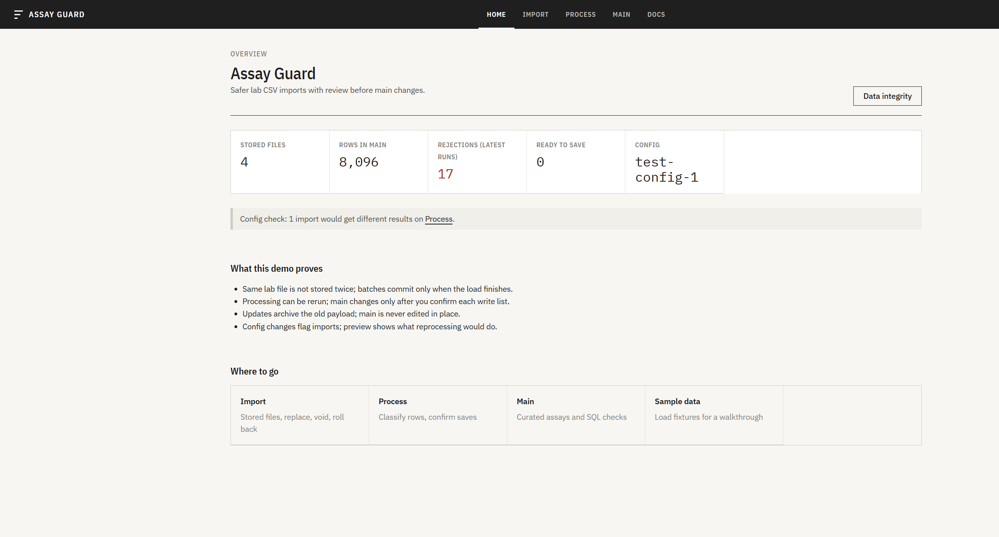
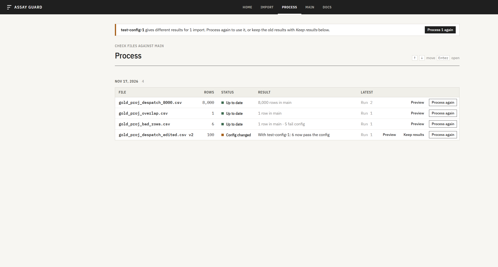
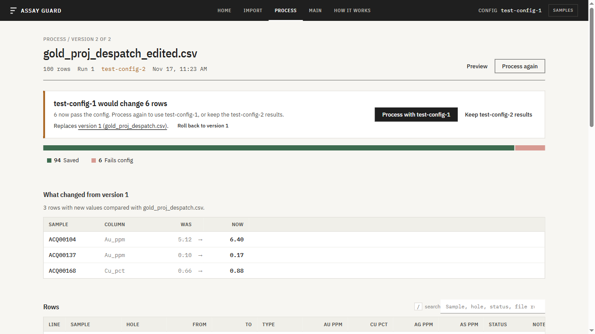
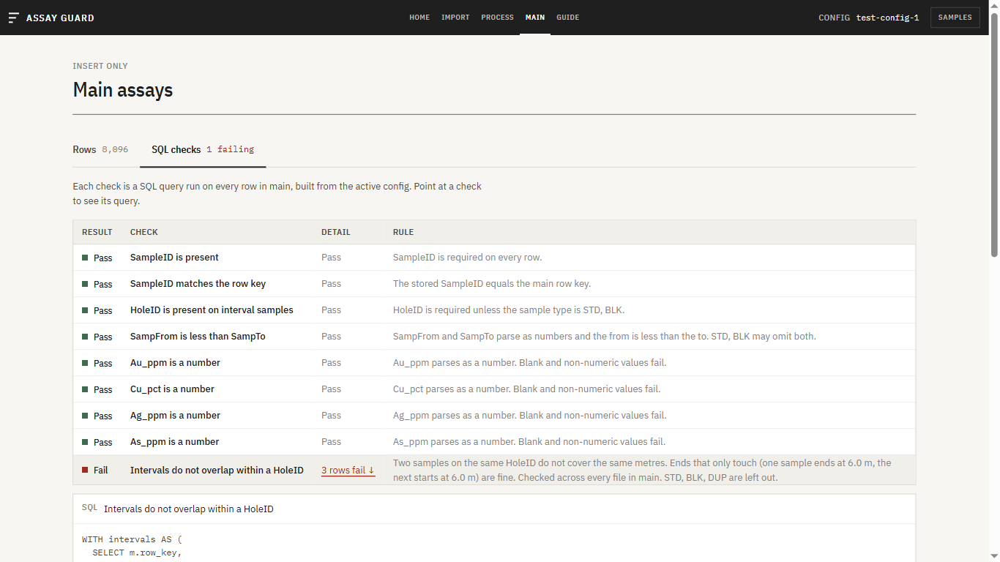

# Assay Guard

**Safe lab CSV → MySQL imports** for geo/mining assay workflows: raw file evidence, processing runs, curated main, and an auditable archive. The UI is small on purpose; the rules below are what you would carry into production.

**Read online (no install):** **[https://craftjd.github.io/assay-guard/](https://craftjd.github.io/assay-guard/)**

## Preview

| Where | Open |
|--------|------|
| **GitHub Pages (this guide, in the browser)** | **[https://craftjd.github.io/assay-guard/](https://craftjd.github.io/assay-guard/)** |
| **Run the app (local Laragon / dev)** | [http://127.0.0.1:8765](http://127.0.0.1:8765) |
| **Docker** | `docker compose up --build` → [http://127.0.0.1:8765](http://127.0.0.1:8765) |
| **GitHub Codespaces** | **Code → Create codespace on main**, then forward port **8765** |

After the app is up, use **Samples** (top right) or **Start fresh** there to load fixture CSVs.

Source: [github.com/craftjd/assay-guard](https://github.com/craftjd/assay-guard) — set `GITHUB_REPO_URL` in `.env` if you use another fork.

### GitHub repository (About box)

Paste these into **Settings → General → About** on GitHub:

| Field | Value |
|--------|--------|
| **Description** | Reference demo for safe lab CSV→MySQL imports—raw evidence, processing runs, curated main, and audit archive for assay / mining workflows. |
| **Website** | https://craftjd.github.io/assay-guard/ |
| **Topics** | `fastapi`, `mysql`, `csv`, `data-integrity`, `mining`, `assay`, `python`, `demo`, `import` |

---

## What you will see

Assay Guard is five screens plus config and sample loads. Screenshots below are from a live local server.

### Home — counts and where to go

Stored files, rows in main, rejections, imports waiting on you, and the active config. **Sample data** loads the walkthrough fixtures.

### Process — queue and config drift

Each import is classified against main. When the config changes, the app tells you how many rows would change and lets you reprocess or **Keep results**.

### Process — one file, versions, and runs

File versions stay read-only; you can roll back, see value diffs vs the prior file, and paginate rows. A **run** is stored only when at least one row’s outcome changes.

### Main — curated assays and SQL checks

Main is what you trust after confirmed writes. **SQL checks** run on the full main table (overlap, required fields, numerics), not one file at a time.

| Page | Role |
|------|------|
| **Home** | Counts: stored files, main rows, rejections, imports ready to save |
| **Import** | Stored files; replace, void, roll back; versioned file names |
| **Process** | Classify rows vs main; confirm adds/updates/removes; runs history |
| **Main** | Curated assays (paged) + SQL checks on full main |
| **How it works** (`/docs` in the app) | Same integrity rules as this README, inside the running app |
| **Config** | Active config module; switch with re-check of imports |
| **Samples** | Fixture loads for a walkthrough |

**Import** — loads commit only after all batches finish. Same bytes are not stored twice. Replace keeps older versions read-only. Roll back undoes a version’s effect on main. Void removes rows from main into archive.

**Process** — preview reclassifies in memory (no save). Confirmed writes check run id + digest. Rows: 25 per page with search and outcome filters.

**Config** — `test-config-1` allows below-detection negatives; `test-config-2` rejects them. After a switch, affected imports are flagged until reprocessed or kept.

---

## Data integrity (what this repo proves)

### Three layers

| Layer | Holds | Rule |
|-------|--------|------|
| **Raw** | Exact file evidence | Same file bytes are stored once (SHA-256). |
| **Processing** | Results of checking each row | Can be rerun when config changes. Each **run** is kept only when something differs from the last run. |
| **Main** | Curated assays you trust | Rows are **added** or **updated only after you confirm**. Updates never overwrite in place. |

**Archive** keeps retired values (replaced, removed, voided, rolled back) so you can audit what changed.

### Row outcomes (per run)

| Outcome | Meaning | Main |
|---------|---------|------|
| **New** | Valid row, key not in main | May add after confirm |
| **Same as main** | Key in main, values match | Skip |
| **Different** | Key in main, values differ | Show diff; update only via archive then insert |
| **Fails config** | Row breaks loaded config | Do not add; may remove from main after confirm |

Config is a named Python module (e.g. `test-config-1`). Headers match **by name**, not column position.

### Two compares

1. **Run vs run** — what changed when you reprocessed or the config changed.
2. **File vs main** — what would add, update, remove, or stay dismissed.

Nothing in main changes until you click a confirmed write. Stale runs and digest mismatches block accidental saves.

### Replace, void, roll back

- **Replace** — new file version; old version stays read-only; main updates only when you save on Process.
- **Void** — rows leave main; copies stay in archive.
- **Roll back** — undo the current file version; restore main from the version before it.

### Global checks

After main is updated, **SQL checks** (required fields, numeric analytes, interval order, hole overlap) run against the full main table, not one file at a time.

### Out of scope in this demo

- Column-mapping studio / synonyms UI
- Multi-user locking or auth
- 30M-row production load (indexed paging is demo-scale only)

---

## Local setup (Windows / Laragon)

1. MySQL running; database `assay_import`.
2. Copy `.env.example` → `.env`.
3. Run `sql/schema.sql` (or start the app once — it migrates).
4. `python -m venv .venv` → activate → `pip install -r requirements.txt`.
5. `uvicorn app.main:app --reload --host 127.0.0.1 --port 8765`
6. Open [http://127.0.0.1:8765](http://127.0.0.1:8765)

## Stack

FastAPI, Jinja2, PyMySQL, static CSS/JS — five pip packages. No React, no ORM.