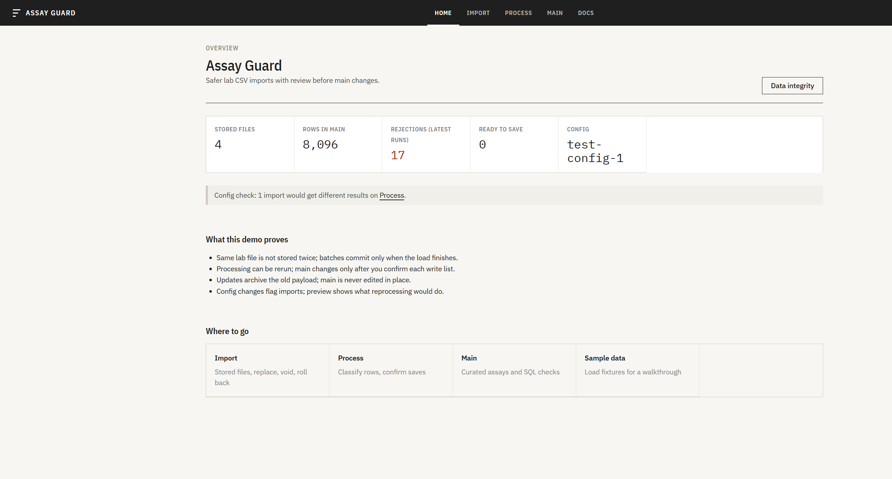
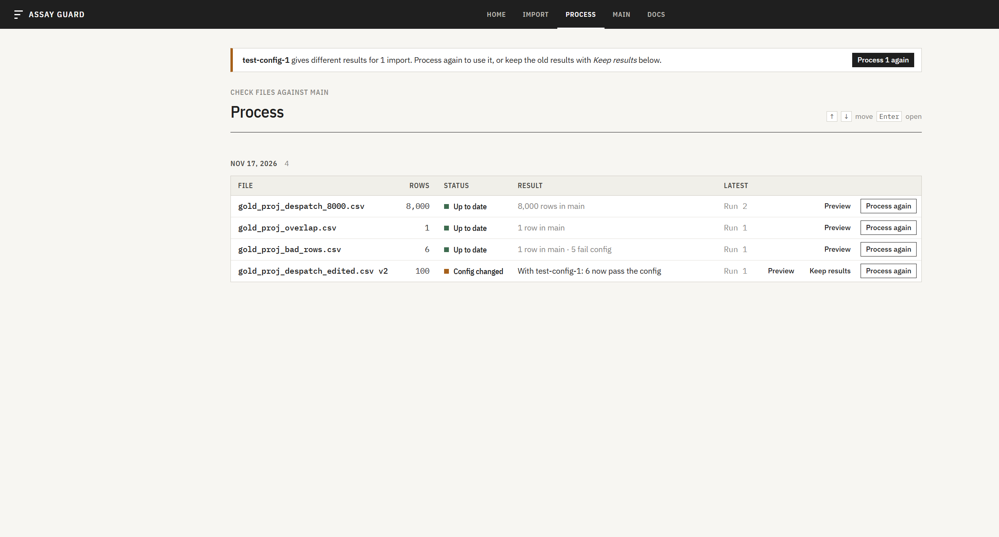
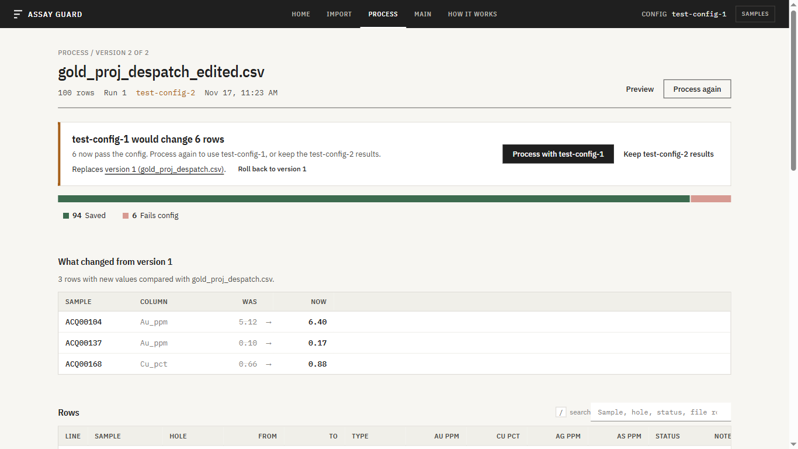
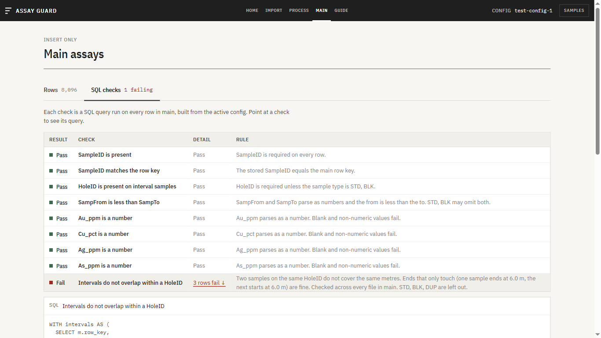

<!-- Same content as README.md — image paths use images/ for GitHub Pages. -->

# Assay Guard

**Lab CSV imports you can stand behind** — a reference demo for exploration and mining teams who move large, shifting assay files into a curated database without waking up to a different main table.

## Why this exists

Labs resend corrections. Headers move. Detection limits and QA rules change mid-project. One load can touch tens of thousands of intervals—and when **main** is wrong, block models, cross-sections, and the story in a technical report all inherit the mistake.

Geoscientists and QPs do not worry about “ETL.” They worry whether **the number in the database is still the number they thought they signed off on**, and whether someone can **show the trail** when it is not.

We are data engineers and developers, not your geological authority. **This demo is our answer to the fears you already voice in import handoffs** — built humbly as a reference you can walk through with engineering, not as a finished product or a substitute for your own QA and sign-off.

| What you need to trust the handoff | What this demo enforces |
|-----------------------------------|-------------------------|
| **No silent overwrites** on intervals you already accepted | **Main** is never edited in place; updates go through archive, then insert, only after you confirm on **Process** |
| **“Which lab file is truth?”** after corrections and reissues | Exact file bytes stored once (SHA-256); **Replace** versions the file and keeps older copies read-only; **Roll back** is explicit |
| **No surprise bulk writes** when a file is bigger or messier than expected | Classify first; **nothing lands in main** until you review outcomes and click a confirmed write |
| **Rules that change** (detection limits, reject logic) should not quietly re-score old loads | Config switch re-flags affected imports; **Preview** and **Keep results** — no hidden saves |
| **Overlap and interval nonsense** caught before it reaches the block model | **SQL checks** on the full **main** table (overlap, order, required fields, numerics)—not one file in isolation |
| **Defensible provenance** when someone asks “where did this assay come from?” | Three layers: raw file evidence → processing **run** → curated **main**, plus **archive** when values retire |

The UI is intentionally small. **The rules below** are what we would carry into production with your validators, naming conventions, and approval workflow.

## Preview

| Where | Open |
|--------|------|
| **Read this site (GitHub Pages)** | [craftjd.github.io/assay-guard](https://craftjd.github.io/assay-guard/) |
| **Source & issues** | [github.com/craftjd/assay-guard](https://github.com/craftjd/assay-guard) |
| **Run the app (local)** | `uvicorn app.main:app --host 127.0.0.1 --port 8765` → [127.0.0.1:8765](http://127.0.0.1:8765) |
| **Docker** | `docker compose up --build` → port **8765** |
| **GitHub Codespaces** | **Code → Create codespace on main**, forward port **8765** |

After the app is up, use **Samples** (top right) or **Start fresh** to load fixture CSVs.

---

## What you will see

A short walkthrough of five screens: where files land, where you decide what reaches **main**, and where whole-table checks run after updates.

### Home — posture before you commit

Counts for stored files, rows in **main**, rejections, imports waiting on you, and the active config—so you know what is loaded versus what still needs a decision. **Sample data** loads the walkthrough fixtures.

### Process — queue and config drift

Each import is classified against **main**. When validation config changes, the app surfaces how many rows would shift and lets you reprocess or **Keep results** instead of assuming yesterday’s run still applies.

### Process — one file, versions, and runs

File versions stay read-only; you can roll back, see value diffs versus the prior file, and work the row list in pages. A **run** is stored only when at least one row’s outcome changes—so history reflects real movement, not noise.

### Main — curated assays and SQL checks

**Main** is what you treat as current after confirmed writes. **SQL checks** run on the full table (overlap, required fields, numerics)—the same scale problem you care about when intervals must line up across holes.

| Page | Role |
|------|------|
| **Home** | Counts: stored files, main rows, rejections, imports ready to save |
| **Import** | Stored files; replace, void, roll back; versioned file names |
| **Process** | Classify rows vs main; confirm adds/updates/removes; runs history |
| **Main** | Curated assays (paged) + SQL checks on full main |
| **Guide** (`/docs` in the app) | Same integrity rules as this README, inside the running app |
| **Config** | Active config module; switch with re-check of imports |
| **Samples** | Fixture loads for a walkthrough |

**Import** — loads commit only after all batches finish. Same bytes are not stored twice. Replace keeps older versions read-only. Roll back undoes a version's effect on main. Void removes rows from main into archive.

**Process** — preview reclassifies in memory (no save). Confirmed writes check run id + digest. Rows: 25 per page with search and outcome filters.

**Config** — `test-config-1` allows below-detection negatives; `test-config-2` rejects them. After a switch, affected imports are flagged until reprocessed or kept.

---

## Data integrity (rules for engineering)

These are the commitments behind the table above—the detail a data engineer should be able to explain back to a P.Geo without hand-waving.

### Three layers

| Layer | Holds | Rule |
|-------|--------|------|
| **Raw** | Exact file evidence | Same file bytes are stored once (SHA-256). |
| **Processing** | Results of checking each row | Can be rerun when config changes. Each **run** is kept only when something differs from the last run. |
| **Main** | Curated assays you trust | Rows are **added** or **updated only after you confirm**. Updates never overwrite in place. |

**Archive** keeps retired values (replaced, removed, voided, rolled back) so you can audit what changed.

### Row outcomes (per run)

| Outcome | Meaning | Main |
|---------|---------|------|
| **New** | Valid row, key not in main | May add after confirm |
| **Same as main** | Key in main, values match | Skip |
| **Different** | Key in main, values differ | Show diff; update only via archive then insert |
| **Fails config** | Row breaks loaded config | Do not add; may remove from main after confirm |

Config is a named Python module (e.g. `test-config-1`). Headers match **by name**, not column position—so a lab reordering columns does not silently map the wrong analyte.

### Two compares

1. **Run vs run** — what changed when you reprocessed or the config changed.
2. **File vs main** — what would add, update, remove, or stay dismissed.

Nothing in main changes until you click a confirmed write. Stale runs and digest mismatches block accidental saves.

### Replace, void, roll back

- **Replace** — new file version; old version stays read-only; main updates only when you save on Process.
- **Void** — rows leave main; copies stay in archive.
- **Roll back** — undo the current file version; restore main from the version before it.

### Global checks

After main is updated, **SQL checks** (required fields, numeric analytes, interval order, hole overlap) run against the full main table, not one file at a time.

### Honest limits (this repo only)

- Column-mapping studio / synonyms UI — your team’s real naming mess is out of scope here.
- Multi-user locking or auth — production would need who-changed-what at login granularity.
- 30M-row production load — indexed paging and fixtures are demo-scale; performance tuning is a separate conversation.

---

## Local setup (Windows / Laragon)

1. MySQL running; database `assay_import`.
2. Copy `.env.example` → `.env`.
3. Run `sql/schema.sql` (or start the app once — it migrates).
4. `python -m venv .venv` → activate → `pip install -r requirements.txt`.
5. `uvicorn app.main:app --reload --host 127.0.0.1 --port 8765`
6. Open [http://127.0.0.1:8765](http://127.0.0.1:8765)

## Stack

FastAPI, Jinja2, PyMySQL, static CSS/JS — five pip packages. No React, no ORM.